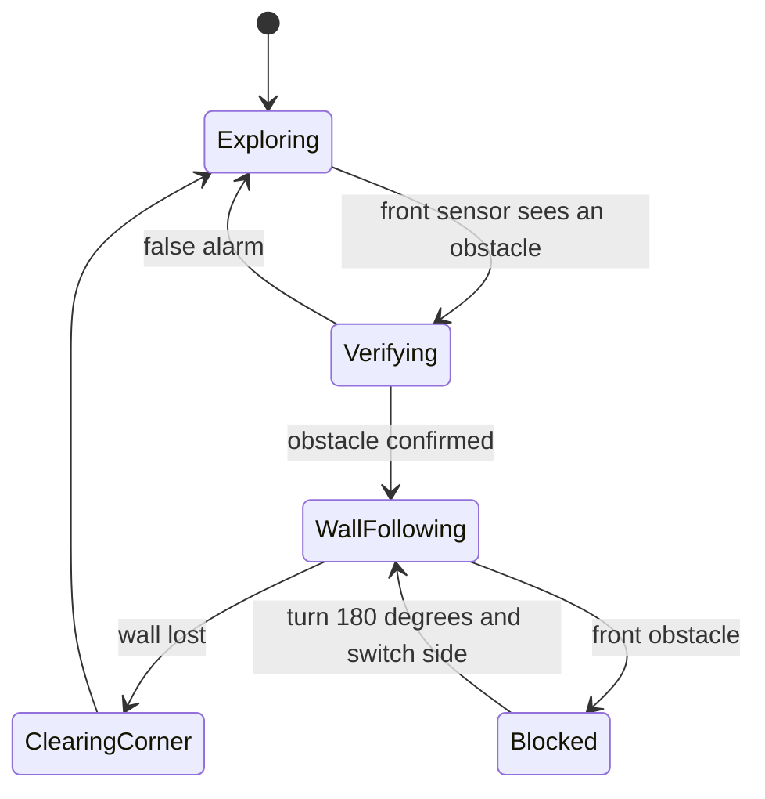

# Raspberry Pi Robot


An autonomous, Roomba-style robot built on a Raspberry Pi 3 to learn **embedded systems** and hardware. It drives around on its own, detects obstacles with ultrasonic sensors and follows walls to get around them. Everything is written in Python, and the behaviour is controlled by a **finite state machine**.

## What it does

- Drives forward at a speed that can be set in the code
- Stops when the front sensor sees something closer than 10 cm and takes several readings over about a second to confirm it, so one noisy reading doesn't trigger a reaction
- Backs up and turns left or right at random
- Follows the obstacle's edge using a second sensor mounted on a servo, which points at the wall
- Drives past the corner when the wall ends, turns back and carries on exploring
- Turns around and tries the other side if it gets blocked on both sides

## Hardware

| Part | Purpose |
|---|---|
| Raspberry Pi 3 | Runs the Python code |
| L298N motor driver | Lets the Pi control the motors' speed and direction |
| DC motors with battery pack | Drive the robot |
| HC-SR04 ultrasonic sensor (front) | Detects obstacles ahead |
| HC-SR04 ultrasonic sensor (rear, on a servo) | Tracks the wall while following it |
| Servo | Turns the rear sensor to the left or right |
| Resistors (1 kΩ and 2 kΩ) | Voltage divider for the sensor's echo signal |
| USB power bank | Powers the Pi, so the robot can run without a computer |

## Wiring (GPIO)

| Part | GPIO pins |
|---|---|
| Front sensor | TRIG 23, ECHO 24 (through voltage divider) |
| Rear sensor | TRIG 20, ECHO 21 (through voltage divider) |
| Servo | GPIO 12 |
| Motor A (L298N) | ENA 25, IN1 17, IN2 27 |
| Motor B (L298N) | ENB 26, IN3 22, IN4 16 |

## How it works

The robot is always in exactly one state, and each state decides what the motors, sensors and servo do and when to move on to the next state.



| State | Behaviour |
|---|---|
| **Exploring** | Drive forward while the front sensor watches for obstacles |
| **Verifying** | Stop and take several readings. Only a confirmed obstacle leads to a reaction |
| **WallFollowing** | Back up, turn 90 degrees to a random side, point the rear sensor at the wall and drive along it |
| **ClearingCorner** | When the wall disappears, drive forward a bit to clear the corner, turn back and reset the servo |
| **Blocked** | Turn 180 degrees, flip the servo and try the other side |

Minimum times in the wall-following state stop the robot from flipping back and forth between states.

## From Godot to a robot: state machines

I had already built finite state machines in Godot (see my [aarpg-game](https://github.com/Lokacoca/aarpg-game) project), where each behaviour of a character lives in its own state with clear rules for when to switch. The same idea carried over directly to this robot:

- **One state at a time:** instead of a growing pile of `if` statements, each state has its own clear responsibility
- **Explicit transitions:** it is easy to see why the robot did something, and to add a new behaviour without breaking the old ones
- **Debug output per state:** I could follow what the robot was "thinking" through the printed state changes, much like watching state changes in a game
- **The difference:** in a game, a state changes because of input and collisions in a simulated world. On the robot the inputs are noisy sensor readings and the actions are real motors, so the transitions needed extra protection such as verification and minimum times

## What I learned about embedded systems

- **Voltage levels matter.** The HC-SR04 outputs 5 V on its echo pin, but the Pi's GPIO pins only tolerate 3.3 V, so I built a voltage divider to avoid damaging the Pi.
- **Power is a design problem.** Motors, a servo, two sensors and the Pi compete for current. A weak or shared supply can make parts misbehave without any error message.
- **Common ground is required.** Parts powered from different sources only work together if their grounds are connected.
- **Sensors are noisy and sometimes fail.** Readings need to be confirmed, and timeouts have to be handled instead of trusted.
- **Hardware needs calibration.** The servo's centre position in code didn't match the real centre, so angles had to be adjusted.
- **Debugging hardware means isolating parts.** Swapping parts, disconnecting sensors one at a time and testing components on their own showed whether the problem was in the code or in the hardware.
- **Running at boot is different from running manually.** Starting the script as a service behaved differently from running it by hand.

## Hardware problems I ran into

| Problem | What I saw | What I did |
|---|---|---|
| 5 V echo signal into a 3.3 V pin | Risk of damaging the Pi | Added a voltage divider (1 kΩ and 2 kΩ) on each echo pin |
| Servo did not move | No movement or sound at all | Suspected power first, then tested with a new servo, which worked straight away |
| Rear sensor stuck at -1 cm | The sensor never got a reply (timeout) | Powered the rear sensor and servo from the L298N's 5 V output with a common ground, after which they worked |
| Sensor and servo failing together | When the rear sonar stopped working, so did the servo | Showed me they were affected by the same shared power |
| Servo centre was off | Code's centre was 45 degrees to the side in reality | Calibrated the servo positions |
| Different behaviour at boot | As a service the wheels were slower, the rear sensor was dead and the servo took about 25 seconds to start, while the same script run from Thonny worked | Pointed to power and initialisation timing at boot, and I added a start delay to the service |

## Running it

1. Wire the robot as in the tables above and connect the battery pack and power bank.
2. Run the program on the Pi:

```bash
sudo python3 CODE.py
```

3. The robot counts down before it starts moving. Press Ctrl+C to stop it.

Speeds, distances and timings are set as constants at the top of the file. To start the program automatically, I run it as a `systemd` service when the Pi boots.

## Limitations

- Turns are controlled by time instead of by measuring rotation, so the angle depends on battery level and surface
- The robot only knows what its two ultrasonic sensors tell it, so odd shapes and narrow gaps can confuse it
